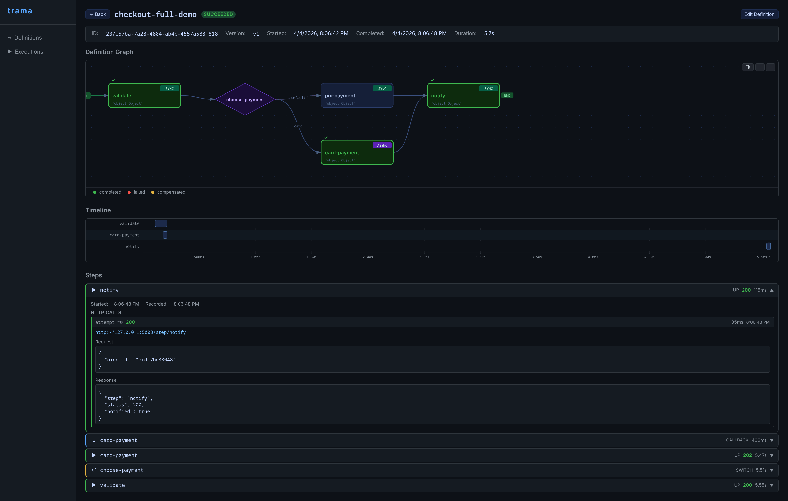
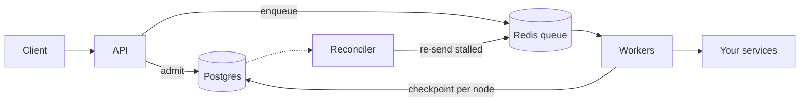

<p align="center">
  <a href="https://trama.run"></a>
</p>

<p align="center">
  <a href="https://trama.run"><b>Website</b></a> ·
  <a href="openapi.json">OpenAPI</a> ·
  <a href="docs/validation-report.md">Validation report</a> ·
  <a href="CHANGELOG.md">Changelog</a>
</p>

<p align="center">
  
  
  
  
</p>

---

**Stop building orchestration logic inside your services.**

Most systems already have a workflow engine. It is just implicit: service A emits an event, B
reacts, C continues, and over time each service grows its own retries, its own async handling
and a cron job to repair what got stuck. Nobody can say where a given order is, or why it
stopped.

Trama makes that flow explicit. You describe it as JSON (HTTP calls, branches, parallel
branches, waits for callbacks, pauses, compensations) and send it to Trama's HTTP API. Trama
runs it, retries it, rolls it back when it has to, and records every step. Your services stay
plain HTTP endpoints: there is no SDK, no worker library and no new programming model.

## What you get

| | |
|---|---|
| **JSON workflows** | A linear list of steps, or a node graph with `task`, `switch` (JSON Logic), `split`/`join`, `sleep` and async tasks. Validate and dry-run a definition offline before deploying it. |
| **Failure handling** | Fixed or exponential retries, then compensation of the completed nodes in reverse order. Completion hooks (`onSuccessCallback`, `onFailureCallback`) tell your system how it ended. |
| **Async callbacks** | An async task hands your service an HMAC-signed, single-use callback URL and parks the execution until it is called or its deadline passes. |
| **Durable by design** | Postgres is the source of truth: every node boundary is checkpointed, and every write is fenced so a stale worker cannot overwrite newer progress. Executions survive worker crashes and Redis data loss. |
| **Scales out without a coordinator** | Workers are the same binary. They split a sharded Redis queue among themselves by rendezvous hashing. A pod can also serve only the API. |
| **Operable** | Prometheus metrics and a Grafana dashboard, OpenTelemetry traces, structured JSON logs, readiness and liveness probes, and a management UI with a graph view and a Gantt timeline of each execution. |

## Example

A payment flow: an async authorization, voided if anything later fails, then a sync capture.

```json
{
  "name": "payment-flow",
  "version": "v1",
  "failureHandling": { "type": "retry", "maxAttempts": 3, "delayMillis": 1000 },
  "entrypoint": "authorize",
  "nodes": [
    {
      "kind": "task",
      "id": "authorize",
      "action": {
        "mode": "async",
        "request": {
          "url": "http://payments/authorize",
          "verb": "POST",
          "headers": { "Idempotency-Key": "{{sagaId}}-authorize" },
          "body": {
            "orderId": "{{payload.orderId}}",
            "callbackUrl": "{{runtime.callback.url}}",
            "callbackToken": "{{runtime.callback.token}}"
          }
        },
        "acceptedStatusCodes": [202],
        "callback": { "timeoutMillis": 30000 }
      },
      "compensation": {
        "url": "http://payments/authorizations/{{payload.orderId}}",
        "verb": "DELETE"
      },
      "next": "capture"
    },
    {
      "kind": "task",
      "id": "capture",
      "action": {
        "mode": "sync",
        "request": {
          "url": "http://payments/capture",
          "verb": "POST",
          "headers": { "Idempotency-Key": "{{sagaId}}-capture" },
          "body": { "orderId": "{{payload.orderId}}" }
        }
      }
    }
  ]
}
```

👉 No polling. No cron. No hidden state machines.

- **Retries:** if `capture` fails, it is retried up to 3 times.
- **Compensation:** if it still fails, Trama runs the compensations of the nodes that completed
  (here it voids the authorization), and the execution ends `FAILED`.
- **Async callback:** the authorization service answers `202` and calls back later. If no
  callback arrives within 30 s, the node fails.

### Templates

JSON request bodies use typed substitution. URLs, headers and non-JSON bodies use
[Mustache](https://mustache.github.io/) templates with destination-specific escaping.
Available values:

| Value | Meaning |
|---|---|
| `{{payload.x}}` (or `{{input.x}}`) | The run's payload |
| `{{nodes.<id>.response.body.x}}` | The response body of a completed node |
| `{{prev.body.x}}` | The previous node's response body |
| `{{sagaId}}`, `{{sagaName}}`, `{{sagaVersion}}` | The execution |
| `{{runtime.callback.url}}`, `{{runtime.callback.token}}` | Async nodes only: where and how to call back |

In JSON bodies, an entire `"{{path}}"` value preserves the referenced JSON type,
including numbers, booleans, null, arrays and objects. References within text accept
scalars only. Missing keys, out-of-range indexes and traversal through null fail
before task HTTP dispatch, with the node, JSON field and reference in the diagnostic.
JSON rendering has no mode header or legacy path. Declare a JSON `Content-Type`;
when no content type is set, bodies starting with `{` or `[` are also treated as JSON.

In text destinations, `{{ }}` escapes the value for where it lands:
- XML entities for XML/HTML bodies;
- form encoding for `application/x-www-form-urlencoded`;
- the literal value in URLs, headers (line breaks removed) and other bodies.

`{{{ }}}` inserts raw values in text destinations only. JSON bodies reject triple
braces, sections and lambdas. See [typed JSON transport](docs/typed-json-transport.md)
for examples and migration requirements.

---

## Quick start

```bash
docker compose up --build
```

- API: http://localhost:9080 (`/readyz` answers `ready` once it can take work)
- Management UI: http://localhost:9000
- Postgres on `:5432`, Redis on `:6379`

Then run the example above inline:

```bash
curl -X POST http://localhost:9080/workflows/run \
  -H 'Content-Type: application/json' \
  -d '{"definition": <the JSON above>, "payload": {"orderId": "ord-1"}}'
# → {"id": "<execution-id>"}

curl http://localhost:9080/workflows/<execution-id>/steps
```

`scripts/` has runnable demos: mock downstream services plus scripts that drive workflows
against them.

---

## Where it fits

| | How it works | Trade-off |
|---|---|---|
| **Choreography** (events and queues) | Each service reacts to the previous one's event. | Fast to start. The order of the flow, its retries and its recovery end up spread across services, with no single place to see an execution. |
| **Trama** | One runtime runs the flow your JSON describes and calls your services over HTTP. | You run Trama, Postgres and Redis. Your services only need to be idempotent HTTP endpoints. |
| **Workflow platforms** (Temporal, Cadence) | Workflows are code, written against an SDK and run by dedicated workers. | Arbitrary logic and long histories, at the cost of a new programming model, SDKs in every service and a platform to operate. |

**Don't use Trama** if you need event sourcing, if your workflow needs logic that does not fit
in JSON Logic conditions and templates, or if you already run Temporal or Cadence
successfully.

---

## Measured

Every release since 2.1 is checked by a fault-injection and load harness
([`loadtest/`](loadtest/README.md)) against Postgres, Redis and a mock downstream on one
8-thread host, with every setting at its default. Full method and results:
[`docs/validation-report.md`](docs/validation-report.md) (2.2.0).

| | |
|---|---|
| **Faults** | 20 scenario runs (Redis restarts with and without persistence, a 30 s Redis outage, `FLUSHALL`, workers killed or frozen past their lease mid-call, a kill storm, overload): **0 lost, 0 stuck, 0 wrong outcomes.** |
| **Load + faults** | 5,000 of 5,000 workflows finished with the expected outcome across a worker kill, a Redis cut and a Postgres cut in the same run. |
| **Throughput** | One process, 64 workers: **229 workflows/s** of 3 sync HTTP tasks each, at 12 ms of Trama CPU per workflow. |
| **Repeated calls** | Only the calls in flight when a worker died were made again (at-least-once; see [Delivery and durability](#delivery-and-durability)). |

The harness shares cores with Postgres, Redis and the mock, so treat the throughput as relative.

---

## Management UI

Trama ships a built-in web interface for managing and debugging workflows.



**Key features:**

- **Definitions** — list, create, edit, and delete saga definitions with a visual graph editor
- **Executions** — search and inspect executions by ID
- **Execution inspector**:
  - Definition graph with per-step status overlay (success / failed / compensated)
  - Gantt timeline showing step latency and compensation phases
  - Per-step request / response detail with HTTP status and duration
  - Retry failed executions from the UI

The UI is served by a lightweight Python BFF (`ui/bff/`) and available at `http://localhost:9000` when running via Docker Compose.

---

## Architecture (simplified)



- **Postgres is the source of truth.** It holds definitions, each execution's state and resume
  point, step history and join barriers.
- **Redis carries the work queue.** It is split into virtual shards that pods divide among
  themselves by rendezvous hashing.
- **Workers are the same binary.** Run as many as you need; a pod can also serve only the API
  (`RUNTIME_ENABLED=false`).

---

## Usage

### Run a workflow

```bash
curl -X POST http://localhost:9080/workflows/run \
  -H 'Content-Type: application/json' \
  -d '{
    "definition": { ... },
    "payload": { "orderId": "ord-1" }
  }'
# → {"id": "<execution-id>"}
```

Or store a definition once and run it by name and version. Running stored definitions works
for linear `steps` (v1) definitions only for now; a stored node graph answers `422`.

```bash
curl -X POST http://localhost:9080/workflows/definitions -H 'Content-Type: application/json' -d @steps-definition.json
curl -X POST http://localhost:9080/workflows/definitions/<name>/<version>/run -H 'Content-Type: application/json' -d '{"payload": {...}}'
```

### Check status

```bash
curl http://localhost:9080/workflows/<execution-id>          # status, failure, timestamps
curl http://localhost:9080/workflows/<execution-id>/steps    # every node result
```

### API

| Endpoint | |
|---|---|
| `POST /workflows/run` | Run an inline definition |
| `GET /workflows?status=&name=` | List executions |
| `GET /workflows/{id}` | Status |
| `GET /workflows/{id}/steps`, `/steps/calls` | Step results and the HTTP calls behind them |
| `POST /workflows/{id}/retry` | Re-run a `FAILED` execution (v1 definitions) |
| `POST /workflows/{id}/wake` | Wake a sleeping execution now |
| `POST /workflows/{id}/node/{nodeId}/callback` | Async callback (`X-Callback-Token` header) |
| `/workflows/definitions` | Create, list, get, update and delete stored definitions; run by name/version |
| `GET /healthz`, `/readyz`, `/metrics` | Probes and Prometheus metrics |

Full contract: [`openapi.json`](openapi.json).

---

## Definition formats

Trama supports two formats.

### Linear steps (v1)

A list of `steps`, each with an `up` call and an optional `down` compensation, run in order.

### Node graph (v2)

`entrypoint` plus `nodes`, each with a `kind`:

| Kind | What it does |
|---|---|
| `task` | An HTTP call: `sync`, or `async` (waits for a callback). Optional `compensation`. |
| `switch` | Picks the next node with JSON Logic `cases` and a `default` |
| `sleep` | Pauses for `durationMillis` |
| `split` | Runs `branches` in parallel, each as its own execution |
| `join` | Continues once every branch of its `split` has finished |

Both formats require `failureHandling`:
- `{"type": "retry", "maxAttempts": 3, "delayMillis": 1000}`; or
- `{"type": "backoff", "maxAttempts": 5, "initialDelayMillis": 500, "maxDelayMillis": 30000}`.

Validate a definition offline with [`trama-validate`](#cli-tools) before deploying it.

---

## Async callbacks

An `async` task sends its request, expects one of `acceptedStatusCodes` (e.g. `202`), and parks
the execution. The request should pass `{{runtime.callback.url}}` and
`{{runtime.callback.token}}` to the service, which later calls back:

```
POST <callback url>                   # /workflows/{executionId}/node/{nodeId}/callback
X-Callback-Token: <token>             # HMAC-signed, single use
Content-Type: application/json

{ ...any body... }
```

- **Outcome.** The callback succeeds unless `callback.failureWhen` matches; `callback.successWhen`
  can require a condition instead. Both are JSON Logic over `callback.body` and `payload`.
- **Timeout.** No callback before `callback.timeoutMillis` fails the node, which is then retried
  or compensated.
- **Configuration.** Callbacks need `RUNTIME_CALLBACK_BASEURL` (the public URL of the API) and
  `RUNTIME_CALLBACK_HMACSECRET`.

---

## Delivery and durability

- **At-least-once.** If a worker dies (or pauses past its claim lease) during an HTTP call, the
  call is made again by the worker that takes over. Make downstream endpoints idempotent, for
  example with a header like `Idempotency-Key: {{sagaId}}-<nodeId>`.
- **Postgres is the source of truth.** Every node boundary records the execution's checkpoint in
  Postgres, and every write is fenced: a worker holding an outdated copy cannot overwrite newer
  progress or a final status.
- **Redis holds the queue.** If Redis loses data, the reconciler re-sends executions that stopped
  advancing, from their last checkpoint (after `reconciler.staleAfterMillis`, default 2 min). AOF
  persistence (`appendfsync everysec`) keeps that delay short.
- **API-only processes.** With `RUNTIME_ENABLED=false` a process serves the API (runs, callbacks,
  queries) and leaves execution to worker processes.

---

## Configuration

Defaults live in [`app/main/resources/application.yaml`](app/main/resources/application.yaml); the most common ones can be set through the environment:

| Variable | Default | |
|---|---|---|
| `PORT` | `8080` | HTTP port |
| `DATABASE_HOST`, `DATABASE_PORT`, `DATABASE_DATABASE`, `DATABASE_USER`, `DATABASE_PASSWORD` | | Postgres (migrated on startup) |
| `REDIS_URL`, `REDIS_TOPOLOGY`, `REDIS_CLUSTER_NODES` | `redis://localhost:6379`, `STANDALONE` | Redis, standalone or cluster |
| `RUNTIME_ENABLED` | `true` | `false` = API-only pod |
| `RUNTIME_WORKERCOUNT` | `32` | Executions a pod runs at once, which also bounds its concurrent downstream calls |
| `RUNTIME_CALLBACK_BASEURL`, `RUNTIME_CALLBACK_HMACSECRET` | | Required for async tasks |
| `RECONCILER_STALEAFTERMILLIS` | `120000` | How long before a stalled execution is re-sent |
| `RATELIMIT_ENABLED` | `true` | Per-workflow breaker on worker failures |
| `METRICS_ENABLED`, `TELEMETRY_ENABLED` | `true`, `false` | Prometheus, OpenTelemetry |

---

## Observability

- **Prometheus metrics** at `/metrics`, with a ready-made Grafana dashboard in
  [`grafana/`](grafana/). Series cover:
  - throughput: `saga_processed_total`, `saga_failed_total`, `saga_retried_total`;
  - durations: `saga_duration_seconds`, `saga_node_duration_seconds`;
  - callbacks: `saga_callback_*`;
  - recovery: `saga_reconciled_total`, `saga_fenced_total`, `saga_redis_errors_total`.
- **OpenTelemetry tracing** (OTLP), one span per execution and per HTTP call.
- **Structured JSON logs.** INFO has one line per execution (`saga finished`, with status and
  duration); per-node detail is at DEBUG.
- **Health probes:**
  - `/readyz` fails fast when Redis is unreachable or the consumer stalls;
  - `/healthz` fails only after `runtime.livenessStallMillis` (2 min) without consumer progress.

---

## Development

```bash
./gradlew run                       # needs Postgres and Redis (see docker-compose.yml)
./gradlew test                      # needs Docker or Podman for Testcontainers
cd ui/management-ui && npm install && npm run dev
```

With Podman, point Testcontainers at its socket, e.g.
`DOCKER_HOST=unix:///run/user/$UID/podman/podman.sock ./gradlew test`.

[`loadtest/`](loadtest/README.md) holds the fault-injection and load harness. Results of each
release's validation are in [`docs/validation-report.md`](docs/validation-report.md).

---

## CLI tools

### validate

Validates a node-graph definition offline, with no running server. It has two phases:

1. **Structural check** — parses the JSON, verifies node IDs are unique, all `next`/`target` references resolve to existing nodes, switch nodes have a `default`, async nodes have a positive `timeoutMillis`, and all required fields are present.
2. **Execution simulation** *(optional)* — walks the node graph using mock responses, renders Mustache templates, evaluates JSON Logic conditions, and prints the full execution trace. Catches bugs that structural checks miss (wrong variable names in templates, switch conditions that never match, etc.).

```
./gradlew trama-validate --args="<definition.json> [scenario.json] [--validate-only]"
```

| Argument | Required | Description |
|---|---|---|
| `definition.json` | yes | v2 saga definition (must contain `nodes`) |
| `scenario.json` | no | mock responses per node; enables simulation |
| `--validate-only` | no | skip simulation even if a scenario is provided |

**Full dry-run with scenario:**

```json
// scenario.json
{
  "payload": {
    "orderId": "ord-demo-001",
    "amount":  "99.90",
    "paymentMethod": "pix"
  },
  "steps": {
    "validate":    { "status": 200, "body": { "valid": true } },
    "pix-payment": { "status": 200, "body": { "charged": true, "method": "pix" } },
    "notify":      { "status": 200, "body": { "notified": true } }
  }
}
```

Only nodes that actually execute need entries in `steps`; unreached branches are ignored.

```
$ ./gradlew trama-validate --args="definition.json scenario.json"

━━━━━━━━━━━━━━━━━━━━━━━━━━━━━━━━━━━━━━━━━━━━━━━━━━━━━━━━━━
  trama validate  ·  checkout-full-demo / v1
━━━━━━━━━━━━━━━━━━━━━━━━━━━━━━━━━━━━━━━━━━━━━━━━━━━━━━━━━━

[1/2] Structural validation
  ✓ 5 nodes  (3 task, 1 switch, 1 async)
  ✓ all node references resolve

[2/2] Execution simulation
  payload: {orderId=ord-demo-001, amount=99.90, paymentMethod=pix}

  → validate             [sync]
      POST    http://localhost:5003/step/validate
      body    {"orderId":"ord-demo-001","amount":"99.90"}
      ← 200   ✓  {"valid":true}

  → choose-payment       [switch]
      matched "pix"  →  pix-payment

  → pix-payment          [sync]
      POST    http://localhost:5003/step/pix-payment
      body    {"orderId":"ord-demo-001","method":"pix"}
      ← 200   ✓  {"charged":true,"method":"pix"}

  → notify               [sync]
      POST    http://localhost:5003/step/notify
      body    {"orderId":"ord-demo-001"}
      ← 200   ✓  {"notified":true}

  ✓ SUCCEEDED

All checks passed.
```

For async nodes the simulator renders the outbound request, marks it as `[async]`, injects a placeholder callback body, and pauses — mirroring production behaviour:

```
  → card-payment         [async]
      POST    http://localhost:5003/async-step/card-payment
      body    {"orderId":"ord-demo-002","method":"card","callbackUrl":"...","callbackToken":"..."}
      ← 202   accepted (execution pauses here in production)
      callback ← {"status":"approved","authCode":"AUTH-9871"}
```

**Exit codes:** `0` = all checks passed · `1` = validation or simulation failed

---

## Used by

**[RiteSmith](https://ritesmith.run)** turns a natural-language intent into a workflow once,
validates it, and hands it to Trama, which runs it from then on without calling an LLM again.
RiteSmith compiles its plans into Trama nodes in code and exposes `POST /trama/execute`, so
task nodes can call its capabilities and its sandboxed Luau scripts.

---

## Known limitations

- **Node-graph (v2) definitions** can be run inline and stored, but not yet run by name
  (`POST /workflows/definitions/{name}/{version}/run`) or retried
  (`POST /workflows/{id}/retry`); both answer `422` for v2.
- **At-least-once.** A call in flight when its worker dies is made again. Downstream endpoints
  must be idempotent.
- **A failed branch does not roll back its siblings.** A `join` reports each branch's outcome;
  reacting to a partial failure (for example with a `switch` after the join) is up to the
  workflow.
- **Conditions are JSON Logic and data flows through templates.** There is no scripting inside
  a workflow; put that logic in a service.

---

## The name

*Trama* is Portuguese for the weft, the thread woven across the warp to make fabric, and also
for a plot. Your services are the warp; Trama is the thread that runs across them and holds
the flow together.

---

## License

Apache License 2.0
